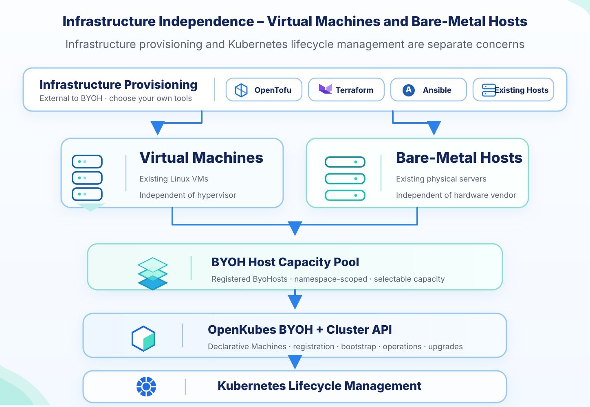

# 01 – Introduction

OpenKubes BYOH (Bring Your Own Host) is a Cluster API infrastructure provider for deploying and managing Kubernetes clusters on existing Linux hosts, whether they are **virtual machines or physical bare-metal servers**.

Unlike infrastructure providers that create and manage compute instances, BYOH operates on hosts that have already been provisioned. Infrastructure provisioning remains the responsibility of the operator and their chosen tooling; Cluster API and OpenKubes BYOH manage the Kubernetes node lifecycle on those hosts.

> **Your infrastructure. Your hosts. Your Kubernetes.**

## Infrastructure independence

A host can be provisioned through OpenTofu, Terraform, Ansible, a virtualization platform, a bare-metal provisioning system, or an existing operational process. BYOH does not require or control a particular cloud, hypervisor, hardware vendor, or infrastructure provisioning tool.

Once a host has been prepared and its BYOH agent has registered with a management cluster, it can be made available in a namespace-scoped BYOH capacity pool. Cluster API can then allocate eligible hosts to Kubernetes control-plane or worker Machines according to the configured selectors and lifecycle resources.

**The boundary is intentional:** BYOH does not create or destroy the underlying VM or physical server. Host preparation, access, operating-system lifecycle, and infrastructure decommissioning remain separate operational responsibilities.

## One provider, two infrastructure types

Virtual machines and bare-metal servers are first-class deployment targets. The same CAPI and BYOH resource model applies to both, subject to supported operating systems, architecture, connectivity, host agent prerequisites, and operational constraints.

The name of the current GitHub repository, `ok-baremetal-byoh`, reflects its history; it does **not** limit the provider to physical hosts. Container-based hosts are also useful for development and testing, but they are not the production deployment model described by this guide.

## Beyond initial provisioning

OpenKubes extends the underlying BYOH provider with a controlled Kubernetes in-place upgrade path. In the validated upgrade workflow, Cluster API coordinates changes while an OpenKubes Runtime Extension and the host agent perform and observe in-place operations. A separate No-Replacement Guard enforces safety restrictions around forbidden replacement actions and unauthorized changes.

The implementation includes package and artifact verification, host-level approvals, health and identity checks, persistent step checkpoints, and evidence collection. These are **specific safety and recovery mechanisms**, not a claim that every cluster topology or failure scenario has been tested.

On 24 November 2026, the OpenKubes E2E lab successfully upgraded a five-node Kubernetes cluster (three control-plane nodes and two workers) on existing Scaleway bare-metal hosts from v1.36.6 to v1.37.2 without replacing Machines or hosts. This demonstrates the tested path on bare metal; it is not a blanket production-readiness guarantee or equivalent E2E evidence for every VM configuration.

## Intended audience and scope

This guide is for platform engineers, Kubernetes administrators, site reliability engineers, and developers who want to operate OpenKubes BYOH directly through **native Cluster API resources, Kubernetes manifests, `clusterctl`, and `kubectl`**. The OpenKubes CLI is not required.

The following chapters cover management-cluster preparation, host registration and permissions, workload-cluster provisioning, networking, operations, in-place upgrades, safety and recovery, and host lifecycle management. They distinguish tested behavior, implementation details, operational constraints, and planned capabilities.

## Project maturity

OpenKubes BYOH remains an **Alpha-stage project**. Compatibility, security boundaries, supported configurations, and production suitability must be assessed for each deployment. The successful in-place upgrade E2E is a concrete milestone within this broader maturity context.

For implementation details and operational constraints, see [Getting Started](https://github.com/openkubes/ok-baremetal-byoh/blob/main/docs/getting_started.md), [Host Registration and Permissions](https://github.com/openkubes/ok-baremetal-byoh/blob/main/docs/host_registration.md), [Host Lifecycle](https://github.com/openkubes/ok-baremetal-byoh/blob/main/docs/host_lifecycle.md), and the [In-Place Upgrade Runbook](https://github.com/openkubes/ok-baremetal-byoh/blob/main/docs/inplace-upgrade.md).
