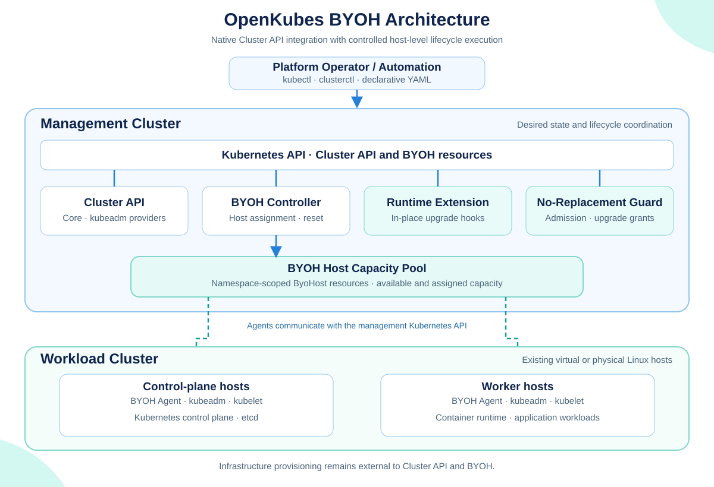
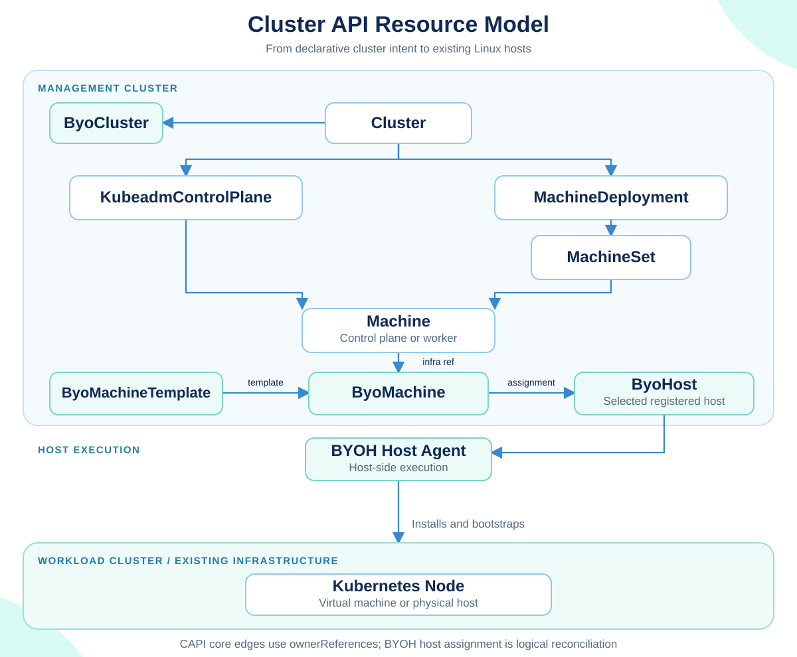
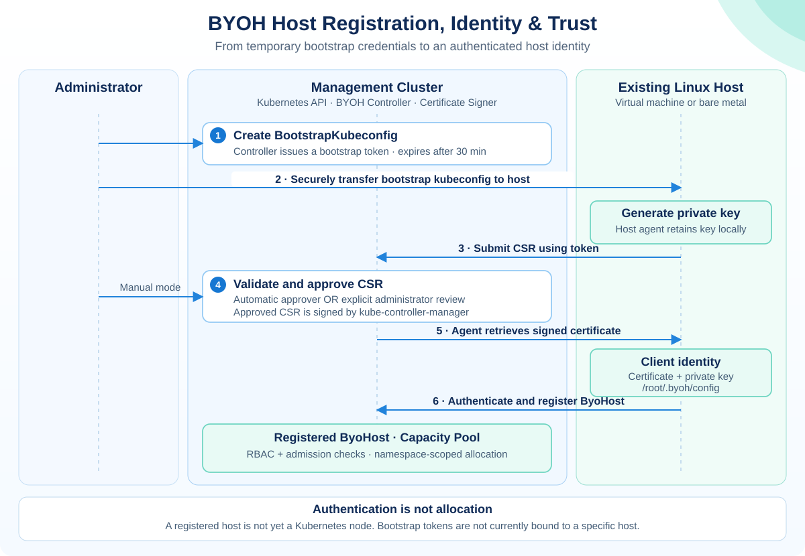
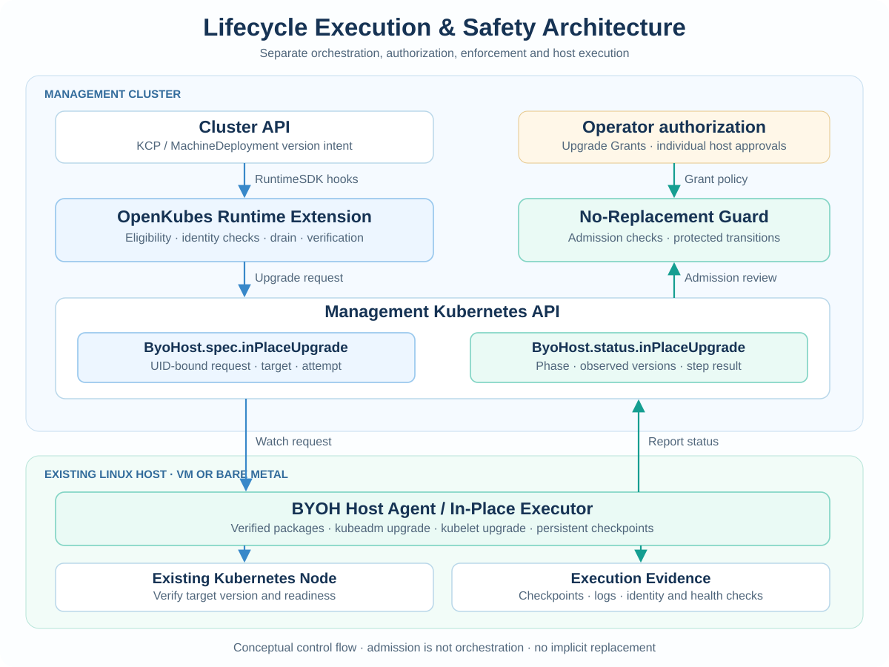
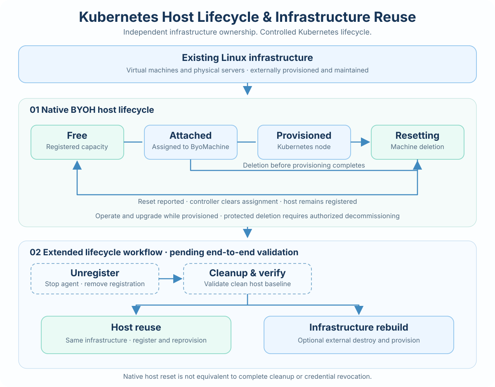

# 02 – Architecture

## 2.1 Management and workload separation

OpenKubes BYOH builds on the native Cluster API architecture. A management cluster hosts the CAPI controllers, BYOH provider and optional lifecycle extensions. Workload clusters run on registered Linux hosts. Infrastructure ownership remains external to BYOH. A host has zero or one Kubernetes nodes at a time.

## 2.2 Native resource model

| Resource | Responsibility |
|---|---|
| Cluster | Desired workload cluster; infrastructure and control-plane references |
| ByoCluster | BYOH cluster infrastructure representation |
| KubeadmControlPlane | Control-plane Machine lifecycle |
| MachineDeployment / MachineSet | Worker configuration and replica reconciliation |
| Machine | Desired individual Kubernetes machine |
| ByoMachineTemplate | Infrastructure template and selection criteria |
| ByoMachine | Infrastructure representation and host assignment |
| ByoHost | Registered existing Linux host |
| Node | Operational Kubernetes node in workload cluster |

The figure depicts logical references, not exhaustive Kubernetes ownerReferences. The BYOH controller selects free hosts matching selectors in the same namespace and binds the assignment to the ByoMachine name and UID. Bootstrap and installation Secrets convey the requested configuration. The host agent executes installation and kubeadm bootstrap; the controller reconciles provider identity. Kubeadm bootstrap and control-plane providers remain native CAPI components.

## 2.3 Host identity and trust

An administrator creates a BootstrapKubeconfig and distributes temporary credentials securely. The agent generates a key and submits a CSR. An approved CSR is signed by kube-controller-manager; the agent stores its client certificate and key locally and registers its ByoHost. Host authentication is separate from Node identity and Machine allocation.

The certificate subject is `CN=byoh:host:<namespace>:<hostname>`, `O=byoh:hosts`; signer `kubernetes.io/kube-apiserver-client`, client authentication usage. The bootstrap token expires after 30 minutes; default certificate lifetime is 365 days, subject to signer limits. Manual CSR approval is recommended for controlled enrollment. The agent runs as root, creates its own ByoHost and subsequently writes status; the controller writes spec, and administrators manage labels and annotations.

Namespace-scoped allocation is not tenant isolation. The documented bootstrap tokens are not bound to a specific host/namespace, host Secret reads remain broad, duplicate names can collide, and removing local credentials does not revoke issued client certificates. Bootstrap token revocation on deletion of BootstrapKubeconfig has been locally validated. See Chapter 5 for enrollment and Chapter 12 for maturity.

## 2.4 Lifecycle execution and safety

Lifecycle capabilities define what the platform can do; safety policies define what it is allowed to do. RuntimeSDK exposes lifecycle hooks; the OpenKubes Runtime Extension coordinates eligible in-place upgrades. The No-Replacement Guard enforces admission rules, not execution. Grants authorize defined UID-bound version transitions; per-host approvals release individual operations. The agent executes verified packages and kubeadm steps, with persistent checkpoints. The extension observes target versions and readiness before reporting completion.

If a hook declines, CAPI may attempt ordinary replacement; an active correctly scoped guard rejects unauthorized operations. A failed upgrade must not silently become replacement. Forward recovery resumes interrupted work after diagnosis and authorized remediation; no in-place downgrade is supported. The one-host-at-a-time check is not an atomic lock; manual releases are the validated hold point. HOTL automation remains pending E2E validation.

The five-host E2E preserved 20/20 Machine, ByoMachine, ByoHost and Node UIDs and three etcd member identities. The guard remains NO-GO for production per the runbook. See Chapters 9–10.

## 2.5 Host lifecycle and infrastructure reuse

Native states: Free → Attached → Provisioned → Resetting → Free. Authorized Machine deletion requests a reset; the agent runs applicable reset and uninstall operations and reports the assignment UID. The controller clears the assignment only after successful reset. A free host remains registered. Native reset is not necessarily a clean OS baseline.

The extended lifecycle contract distinguishes reset, unregister, cleanup and optional infrastructure destruction. Teardown of a protected cluster requires separately authorized decommission. Reset may need to precede unregister so the agent can complete its work. Cleanup must verify a defined baseline without deleting unrelated infrastructure or data. Host reuse preserves infrastructure, not old Kubernetes object identities; full reuse and HOTL workflow validation remains pending. See Chapter 11.

## 2.6 Responsibility boundaries

| Responsibility | Component |
|---|---|
| Infrastructure and OS | External operator/tooling |
| Cluster desired state | CAPI |
| Host allocation | BYOH controller |
| Bootstrap configuration | Kubeadm bootstrap provider |
| Host execution | BYOH agent |
| Upgrade coordination | Runtime Extension |
| Safety enforcement | Guard and admission policies |
| Authorization | Operator and approved policies |

> OpenKubes owns the contracts, not the components.

References: [Host registration](../host_registration.md), [Host lifecycle](../host_lifecycle.md), [Upgrade runbook](../inplace-upgrade.md).
