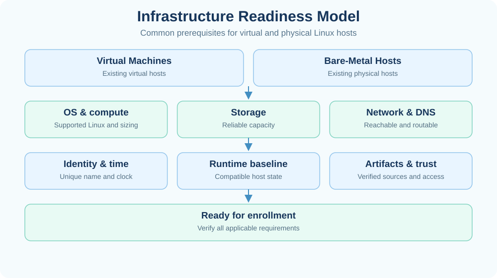

# 03 – Infrastructure Requirements

Virtual machines and physical servers are equal deployment targets. Hypervisor and hardware examples are potential environments, not certified platforms. Docker hosts are intended for development and testing. The operator provides existing Linux hosts and network connectivity.



## Operating system and sizing

The documented default installer supports Ubuntu 24.04 and 26.04 on amd64 and arm64. CI exercises Kubernetes v1.36.6 and v1.37.2 in container-based tests; the v1.35 line appears only in version-skew unit tests (for example v1.35.0 and v1.35.9), not as a container-tested upgrade target. This does not imply real-host upgrade coverage on all combinations. Custom installers require separate compatibility validation.

Illustrative lab sizing per host: 4 CPU cores, 8 GiB RAM, 80 GiB SSD. These are not enforced minimums. Size for workloads and system overhead; ensure low-latency reliable etcd storage. A two-host lab uses one control plane and one worker; the five-host HA reference uses three stacked-etcd control planes and two workers, excluding management and external load-balancing capacity.

## Runtime and OS baseline

The default installer installs containerd 2.4.2 and runc 1.5.2 (documented defaults), Kubernetes packages at the desired version, cri-tools and systemd cgroups. It configures swap, kernel modules and sysctls. Conflicting distribution packages (`containerd`, `containerd.io`, `docker.io`, `runc`) cause failure. Existing runtime configurations need review. The operator owns OS preparation and firewall rules.

## Connectivity and identity

The agent must reach the management API over verified TLS. Workload hosts need a stable workload API endpoint and CNI-specific connectivity. Ensure DNS, non-overlapping network ranges, appropriate MTU, restricted firewall paths, artifact repository access and synchronized clocks. Default Kubernetes ports include TCP 6443, 2379–2380 and 10250; other component and NodePort/CNI ports depend on configuration. Do not expose these indiscriminately. See Chapter 7.

Use unique lowercase DNS-compatible hostnames within the registration namespace; globally unique names are recommended. Review root access and trust assumptions. Hosts need configured access to Kubernetes packages, runtime releases, OS dependencies and container images; mirrors and disconnected deployments require separate validation.

## Read-only inspection

```bash
cat /etc/os-release
uname -m
dpkg --print-architecture
hostnamectl --static
nproc
free -h
lsblk
df -h /
timedatectl status
ip -brief address
ip route
swapon --show
```

## Readiness checklist

- [ ] Supported OS and CPU architecture
- [ ] Adequate compute, storage and memory
- [ ] Unique hostname, DNS and synchronized clock
- [ ] Management API reachable with trusted TLS
- [ ] Workload network and firewall paths reviewed
- [ ] Compatible runtime baseline and artifact access
- [ ] Administrative access and host trust reviewed
- [ ] Previous cluster state, credentials, backups and recovery reviewed

These checks are not a complete automated preflight.

References: [README](../../README.md), [Installer](../installer.md), [Getting Started](../getting_started.md).
