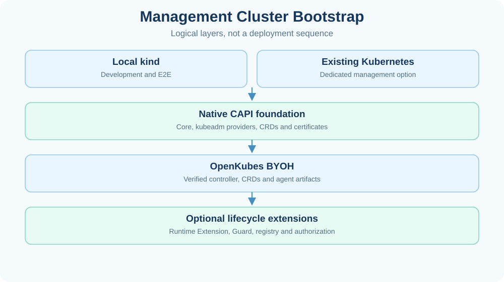
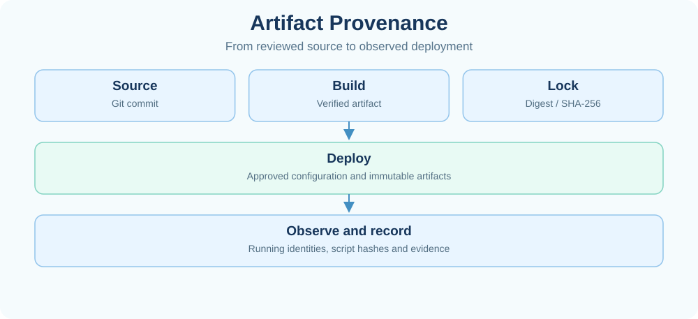

# 04 – Management Cluster

The management cluster hosts CAPI, BYOH and optional lifecycle extensions. Its placement is independent of workload infrastructure. kind is a local test bootstrap option; a dedicated long-lived management plane is an architectural target, not a production readiness claim.



## Compatibility and provenance

Reference: kind with Kubernetes v1.36.4, CAPI v1.14.4, matching kubeadm providers, BYOH v1beta1 contract. The documented CAPI v1.14 management Kubernetes range is v1.33–v1.37. Verify all selected versions, including cert-manager. Pin source commits, image digests, agent artifact SHA-256, package checksums and manifests. Record actual running identities and actual executed script hashes; hash verification alone does not establish authenticity or security. Automatic script evidence coverage remains a follow-up requirement.



## Bootstrap example (review required)

Install verified versions of kubectl, clusterctl, kind, Docker, Git, OpenSSL and rendering tools. Example local configuration:

```yaml
kind: Cluster
apiVersion: kind.x-k8s.io/v1alpha4
name: ok-management
networking:
  apiServerAddress: "127.0.0.1"
  apiServerPort: 6443
nodes:
  - role: control-plane
```

Save as `management-kind.yaml`. Select an approved immutable node image before use. Loopback is local-only; external hosts need a reachable, restricted endpoint with valid TLS identity.

```bash
kind create cluster --config management-kind.yaml --image "${VERIFIED_KIND_NODE_IMAGE:?approved image required}"
export MGMT_KUBECONFIG="$HOME/.kube/config"
export MGMT_CONTEXT=kind-ok-management
kubectl --kubeconfig "$MGMT_KUBECONFIG" --context "$MGMT_CONTEXT" get nodes -o wide
kubectl --kubeconfig "$MGMT_KUBECONFIG" --context "$MGMT_CONTEXT" get --raw='/readyz?verbose'
```

Explicit context is necessary but not sufficient: verify API endpoint and CA fingerprint against trusted expected values. Once created, bind protected operations to workload Cluster UID and namespace, and verify workload kubeconfig independently.

## Native providers

Illustrative pinned CAPI initialization, pending exact CLI and artifact validation:

```bash
clusterctl init --kubeconfig "$MGMT_KUBECONFIG" --kubeconfig-context "$MGMT_CONTEXT" \
  --core cluster-api:v1.14.4 --bootstrap kubeadm:v1.14.4 --control-plane kubeadm:v1.14.4
```

Inspect deployments, CRDs, certificates, provider inventory and running image IDs. The verified OpenKubes BYOH provider manifest and metadata must be obtained from an approved revision. Do not silently install upstream Superbrothers assets when OpenKubes extensions are required. Release-based and verified-manifest installation paths remain packaging review items; no release URL is invented. Enable manual CSR approval (`MANUAL_CSR_APPROVAL=enable`) through the verified installation configuration.

## Optional in-place extensions

Native initial provisioning does not require the upgrade extension. Protected upgrades require compatible BYOH CRDs/controller/agents, approved authorization identities, namespace-scoped execution RBAC, guard registry and policies, pinned extension and package lock, RuntimeSDK/InPlaceUpdates gates on applicable CAPI controllers, and ExtensionConfig discovery. Follow the reviewed rollout sequence and approvals, especially for existing clusters.

`config/inplace/base` contains namespace, guard, extension, webhooks, hardening, ExtensionConfig and package lock. It is not a standalone deployment: images are intentionally unpinned and a reviewed overlay must supply digests, trusted registry, protected namespaces and RBAC. Do not apply the base directly.

Verify discovered handlers and actual hook responses, fail-closed behavior and negative tests in a dedicated test environment. Ready deployments alone are insufficient. Keep management and workload credentials separate and establish independent backup and restore testing. Guard production security remains NO-GO.

## Readiness checklist

- [ ] Management endpoint, CA, context and Kubernetes compatibility verified
- [ ] CAPI and kubeadm providers, BYOH CRDs/controller and certificate services ready
- [ ] Approved images and agents verified; CSR policy configured
- [ ] External host connectivity verified; credentials protected
- [ ] Backup and recovery strategy established
- [ ] If extensions are enabled: reviewed overlay, feature gates, registry, grants/RBAC, hooks and negative tests verified

Management move/pivoting, same-plane and disaster recovery remain separate validation milestones.

References: [Getting Started](https://github.com/openkubes/ok-baremetal-byoh/blob/main/docs/getting_started.md), [Upgrade runbook](https://github.com/openkubes/ok-baremetal-byoh/blob/main/docs/inplace-upgrade.md), [Base manifests](https://github.com/openkubes/ok-baremetal-byoh/tree/main/config/inplace/base).
