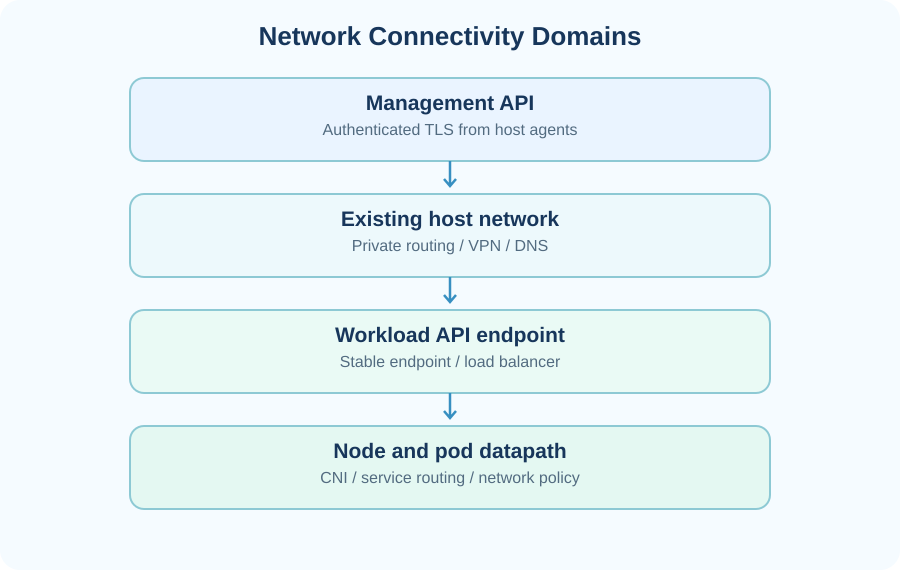

# 07 – Networking

Design the management control path, workload API path, node underlay and pod datapath independently. A BYOH agent initiates authenticated TLS access to the management API; the workload node also needs its own cluster API connectivity. Do not confuse these endpoints.

## Management connectivity

Use private routed networks, a trusted VPN or another authenticated connectivity design. Verify routing, DNS, CA trust and endpoint SANs from every host. A loopback-only kind API cannot be reached directly by external hosts. Do not expose an unprotected management endpoint or disable TLS checks to work around routing problems.

## Workload API and high availability

Provide a stable endpoint for the Cluster controlPlaneEndpoint. A TCP load balancer such as HAProxy is one possible implementation. Validate listener, backend health checks, reachability, DNS and TLS certificate SANs. A single load balancer may be a single point of failure. Stacked etcd needs reliable low-latency peer communication and persistent storage. Test API behavior during individual control-plane maintenance rather than promising uninterrupted service.

## CNI and address planning

Select a Kubernetes-compatible CNI, pin the chart/manifests and image digests, and review the selected datapath mode, encapsulation, encryption, MTU, kube-proxy behavior and network policy. Pod and service CIDRs must not overlap the underlay, VPN or each other. The reference lab uses Cilium; the historical upgrade used 1.21.0-pre.4 under an explicit lab-only exception. Do not reproduce that exception as a default. Verify a stable compatible release and the current repository compatibility lock before proceeding; availability of 1.21 GA has not been checked here.

## Connectivity matrix

| Source | Destination | Requirement |
|---|---|---|
| Host agent | Management API | Configured HTTPS endpoint |
| Nodes and clients | Workload API | Configured endpoint, typically TCP 6443 |
| Control planes | etcd | TCP 2379/2380 as required |
| Control plane | kubelet | TCP 10250 as required |
| Nodes | Nodes | CNI-specific ports and protocols |
| Hosts and pods | DNS and artifact sources | Approved resolution and egress |
| Clients | Application services | Only explicitly authorized ingress |

The installer does not configure firewalls. Restrict access to trusted paths and account for the actual CNI mode. Do not open all ports globally.

## Verification

Inspect `ip -brief address`, `ip route`, `getent hosts <endpoint>` and the configured TLS endpoint using trusted CA material. From the verified workload context, inspect `kubectl get nodes -o wide`, `kubectl get pods -A`, and `kubectl get networkpolicy -A`. Validate cross-node pod traffic, service routing, DNS, policy allow/deny, API access and MTU-sensitive paths using approved test workloads. The repository's `hack/inplace/netcheck.sh` provides reference checks; inspect its requirements and identity gates before execution. Record results before and after upgrades.

References: [Installer](https://github.com/openkubes/ok-baremetal-byoh/blob/main/docs/installer.md), [In-place tooling](https://github.com/openkubes/ok-baremetal-byoh/tree/main/hack/inplace), [Kubernetes ports](https://kubernetes.io/docs/reference/networking/ports-and-protocols/).
