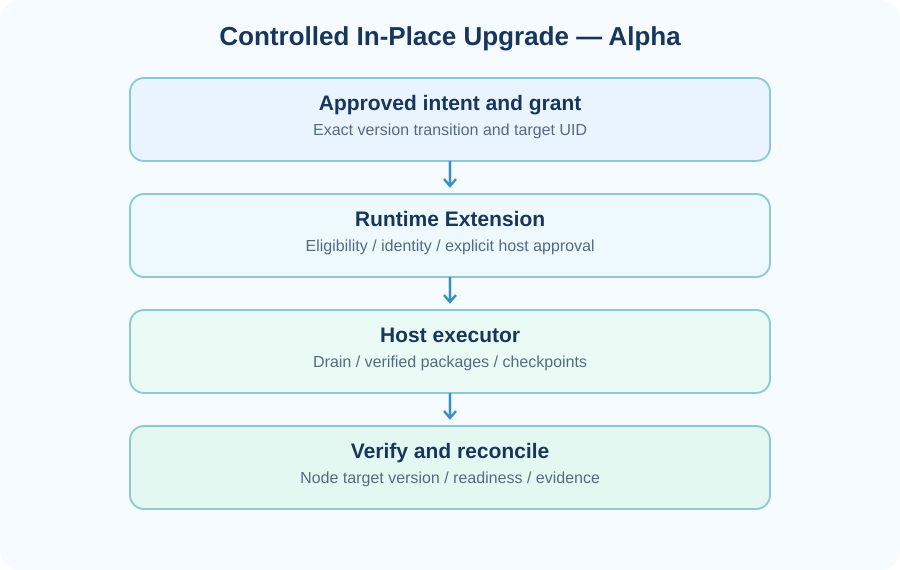

# 09 – In-Place Upgrade

The reference path is Kubernetes v1.36.6 to v1.37.2 under CAPI v1.14.4. It was executed in a five-host DEV/E2E lab on 24 November 2026. The current Guard security review is NO-GO for production. Do not infer support for arbitrary upgrade paths or CPU/OS combinations.

## Prerequisites and gates

Verify the reviewed package lock, image digests and agent binary; compatible CNI; management/workload identity; healthy baseline and UID snapshot; independently stored etcd backup with restore verification; discovered Runtime Extension and actual hook behavior; configured trusted registry, protected namespace and fail-closed Guard; scoped drainer credentials; authorization identities; KCP surge zero; and full applicable test suites. The latest agent from PR #40 must be independently verified and validated in the next lab run, not described as tested in the historical run.

## Declare and authorize intent

A grant is bound to the KCP or MachineDeployment UID and exact source/target versions, with a defined expiration. Use one grant per target, without machineUID; overlapping valid grants cause ambiguity and denial. Separate approver and initiator identities. Review generated grants before creation and claim. Grant expiry does not authorize removal of protection or destructive recovery.

The authorized initiator changes the KCP version first, then the worker MachineDeployment template version only after control-plane completion. Use resourceVersion-bound changes and the repository's reviewed procedures. No unconditional patch command is provided because identity and grant checks are essential.

## Host execution

RuntimeSDK hooks evaluate in-place eligibility. Unsupported changes can result in CAPI replacement attempts; the configured Guard must reject unauthorized fallback. The extension verifies the Machine/ByoMachine/ByoHost chain, waits for the explicit host approval, drains using eviction respecting PDBs, and requests execution. The agent persists checkpoints, verifies package hashes, upgrades kubeadm and kubelet, and reports observed versions. The extension verifies the Node independently and uncordons after success.

CAPI chooses the next eligible Machine; the operator must verify which host is selected, not force selection through deletion annotations. Control planes precede workers. Approve exactly one host and wait for verified completion before the next. The one-host-at-a-time check is not an atomic lock.

## Operational tooling

The repository provides `hack/inplace/preflight.sh`, `progress.sh`, `host-step.sh`, `uids.py`, `monitor.sh`, `netcheck.sh`, `render_grant.py` and `etcd-snapshot.sh`. Use the documented arguments and explicit identity environment in the pinned runbook, not inferred invocation flags. Inspect the actual hook response before approving a host. Stop on unexpected denial, inconsistent versions, unhealthy etcd, failed readiness or evidence mismatch.

## HITL versus HOTL

Manual host approvals (HITL) were validated. Plan-level authorization with automated host release (HOTL) remains pending E2E validation. Future automation must enforce serialization, current grant validity, health and identity gates, explicit stop conditions and durable audit evidence. It must not simply annotate all hosts in advance.

References: [Runbook](../inplace-upgrade.md), [Executed E2E protocol](../scaleway-kubeadm-e2e/inplace-upgrade-testprotocol.md).
