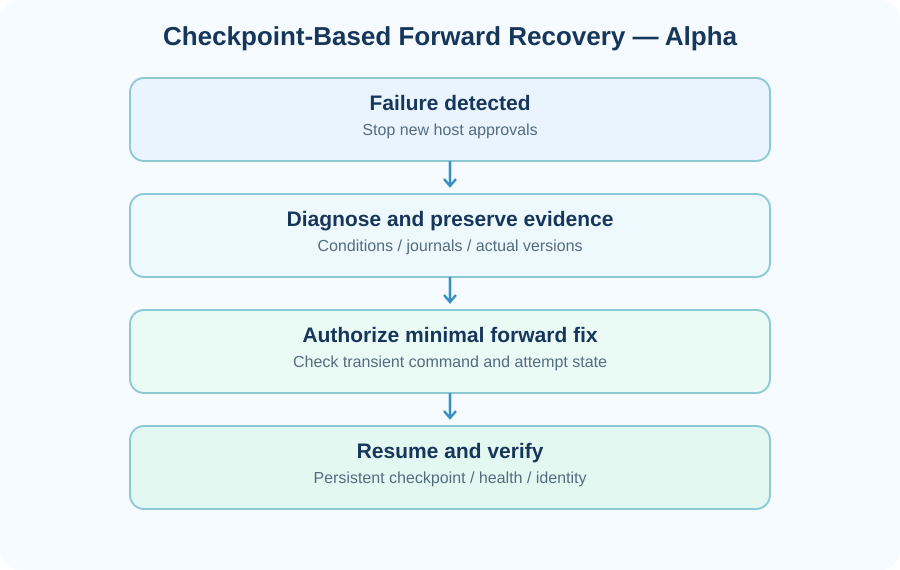

# 10 – Safety & Recovery

Safety policies define what the platform is allowed to do; lifecycle extensions define what it can do. Neither replaces operational authorization.

## Safety contract

The Guard evaluates protected API transitions and rejects unauthorized replacement. Protection depends on the trusted registry, namespace labels, admission configuration and identities. A missing or inconsistent protection configuration must not be treated as permission to proceed. Validate both allowed and denied paths, including outage behavior where appropriate in an isolated lab. Cluster administrators retain break-glass capabilities; the Guard is not a boundary against a fully privileged administrator.

## Forward recovery

On failure, stop new host approvals and preserve evidence. Inspect agent journal, ByoHost status, checkpoint phase, runtime hook decisions, admission denials and actual host/Node versions. Diagnose the cause and apply a minimal reviewed forward fix. The agent resumes using persistent checkpoints; explicit attempt increment may be required after failure. Verify that no previous transient systemd command is still running before approving another attempt. Never edit checkpoint files, remove CAPI pending hooks, downgrade Kubernetes or reset the host as routine recovery.

Three reference cases were exercised: agent failure followed by checkpoint resume; extension hook failure followed by corrected extension and controlled CAPI restart; Guard denial of legitimate MachineSet label reconciliation followed by a narrowly scoped fix. These are documented cases, not universal recovery guarantees.

## Disaster recovery

An etcd snapshot is not a transactional rollback of Kubernetes packages or host state. Restoring etcd may discard writes after the snapshot and requires a separate compatibility and recovery plan. Management cluster loss is a separate scenario from workload etcd failure. Store independent backups and verify restoration in isolation. Full management disaster recovery remains pending validation.

## Evidence and stop conditions

Collect before/after resource UIDs, versions, etcd membership and health, API probe results, networking tests, logs, grants and operator decisions. Record the actual executed script bytes and Git commit rather than substituting a later corrected version. Seal the evidence manifest with SHA-256; keep secrets and kubeconfigs out. Automatic script evidence capture is a required improvement, not a universally implemented feature.

References: [No-Replacement ADR](../adr/ADR-001-byoh-no-replacement-safety.md), [Runbook](../inplace-upgrade.md).
