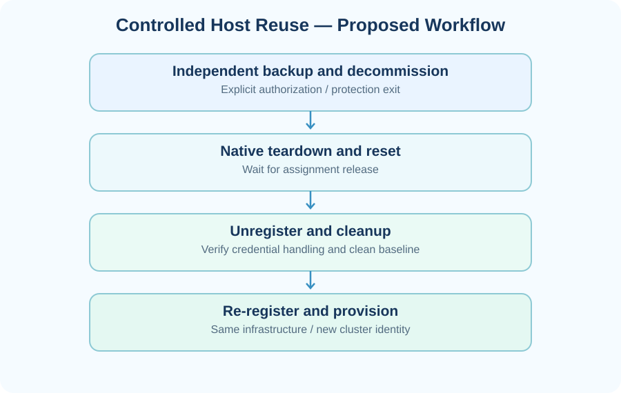

# 11 – Cluster Lifecycle

**Maturity: native reset documented; extended host reuse workflow pending E2E validation.** This chapter defines the proposed contract, not an approved destructive runbook.

## Controlled lifecycle exit

The protected namespace blocks Machine and KCP/MD creation/deletion. The documented decommission procedure requires confirming no active upgrade, explicit platform-admin authorization, removing the namespace from the trusted registry and rolling the Guard, then removing the protection label and verifying an intended server-side dry-run deletion is admitted. Removing the label alone does not remove protection. Review grant expiry and ongoing operations before decommission. Maintain independent backups before destructive work. The procedure has not yet been fully validated in the planned host reuse E2E.

## Native reset versus unregister

Deleting an authorized Machine requests a reset. The agent performs kubeadm reset and applicable uninstall, then reports the reset UID; the controller releases the assignment. The Machine deletion waits for reset completion. A free ByoHost remains registered. Do not unregister or stop the agent before reset if it is needed to complete that reset. The exact high-level Unregister operation may therefore need to orchestrate teardown before removing enrollment; the conceptual lifecycle label is not a literal command sequence.

After release, an approved unregister workflow stops or removes the agent, deletes the free ByoHost and handles bootstrap resources and local credentials. Previously issued certificates may remain valid until expiry. Deleting a ByoHost alone does not revoke the certificate or prevent a running agent from re-registering.

## Cleanup and host reuse

Define an allowlisted clean baseline for Kubernetes packages, runtime data, CNI residuals, etcd data, kubeconfigs, enrollment credentials, services and network configuration. Distinguish expected retained infrastructure configuration and user data from cluster residue. Avoid generic destructive cleanup scripts. Validate the baseline independently before new enrollment.

The proposed next E2E is: independent backup; controlled decommission; authorized teardown and reset; unregister; reviewed cleanup; baseline checks; reprovision on the same physical/virtual infrastructure; verify the new agent from PR #40; deploy v1.36.6; execute a gated automated upgrade to v1.37.2 only after HOTL safety requirements are met. Reuse preserves infrastructure identity, not the Kubernetes object UIDs from the removed cluster. Capture new UIDs as the next upgrade baseline.

## Optional infrastructure rebuild

Destroy/rebuild is owned by external infrastructure tools, not BYOH. It requires a separate authorization and data-retention decision. Management move/pivoting and disaster recovery follow as separate validation milestones.

References: [Host lifecycle](https://github.com/openkubes/ok-baremetal-byoh/blob/main/docs/host_lifecycle.md), [In-place runbook](https://github.com/openkubes/ok-baremetal-byoh/blob/main/docs/inplace-upgrade.md).
