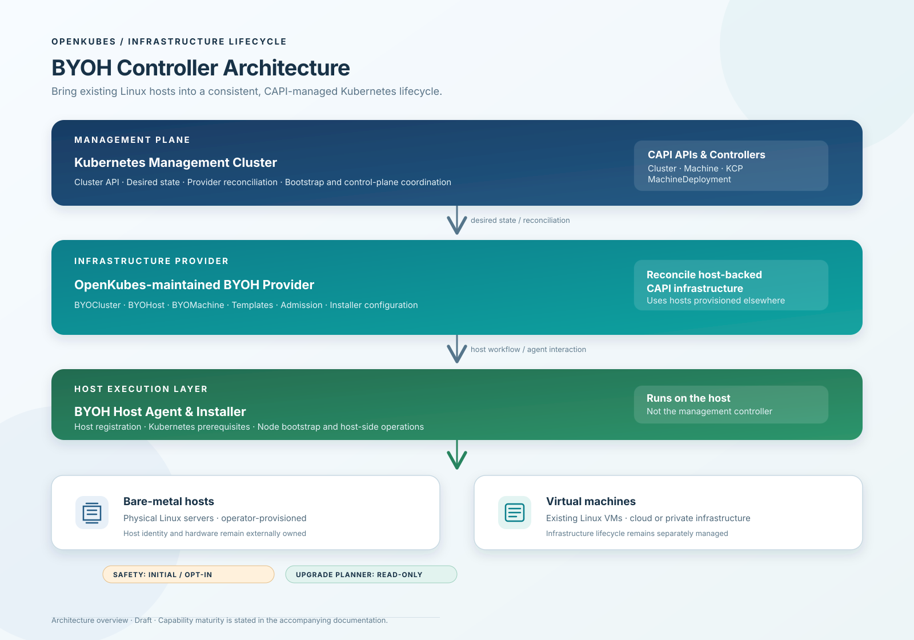

# OpenKubes BYOH Controller

**Status:** Architecture overview draft  
**Implementation repository:** `openkubes/ok-baremetal-byoh`  
**Architecture decisions:** [ADR-Platform-047](https://github.com/openkubes/openkubes/blob/main/architecture/decisions/ADR-Platform-047-no-replacement-and-inplace-upgrade-exceptions.md) and [ADR-Platform-048](https://github.com/openkubes/openkubes/blob/main/architecture/decisions/ADR-Platform-048-infrastructure-lifecycle-strategies.md)  
**CAPI compatibility baseline:** Cluster API v1.14.x; validate exact component versions before relying on a specific lifecycle behavior.

> This document describes the current OpenKubes-maintained BYOH provider, the safety work merged in PR #23, and the intended lifecycle direction. It distinguishes implemented capabilities from design and implementation work that remains open.

## Why OpenKubes maintains a BYOH controller

Cluster API (CAPI) provides declarative APIs and reconciliation for Kubernetes cluster lifecycle. The Bring Your Own Host (BYOH) infrastructure provider allows operators to use already-provisioned Linux hosts without coupling Kubernetes node lifecycle to a specific infrastructure service.

OpenKubes maintains a downstream fork of the BYOH provider so that existing physical and virtual Linux hosts can participate in a CAPI-managed cluster lifecycle. This separates infrastructure/host provisioning from Kubernetes node provisioning while retaining CAPI as the cluster lifecycle API and reconciliation framework.

The engineering focus is not to replace CAPI with another provisioning engine. It is to make the host integration, lifecycle boundaries, upgrade safety and operational evidence explicit for OpenKubes environments.

## Component model

### CAPI management cluster

The management cluster hosts CAPI and the BYOH infrastructure provider. CAPI resources express desired cluster and Machine state. CAPI controllers coordinate infrastructure, bootstrap and control-plane lifecycle through their respective provider contracts.

### OpenKubes-maintained BYOH provider

The repository is a downstream fork of the superbrothers BYOH provider, itself descended from the former VMware Tanzu provider. The existing provider implementation includes controllers and APIs for BYOCluster, BYOHost, BYOMachine, templates, admission and installer configuration.

The BYOH provider integrates pre-provisioned hosts into CAPI. It does not provision the underlying physical server or virtual machine; that remains the responsibility of the infrastructure owner or provisioning system.

### BYOH host agent and installer

The BYOH host agent runs on a registered host and participates in the provider's host-registration and node-bootstrap workflow. Installer components prepare Kubernetes host dependencies and configure the host for its role as a Kubernetes node.

The provider and agent have distinct responsibilities: the management-cluster controllers reconcile CAPI/BYOH resources, while host-side components perform the host operations defined by the BYOH workflow.

### No-Replacement safety work

PR #23 introduced an initial No-Replacement policy package, trusted registry parsing, Cluster UID verification, Machine admission handling, an opt-in registration path in the manager, and a standalone Guard image build definition.

This is an initial safety implementation, not a complete operational deployment. The Machine webhook is not yet wired into the shipped ValidatingWebhookConfiguration; safe namespace selection, deployment/TLS/RBAC wiring, registry distribution, and the authorized in-place exception path remain open. Do not enable it as production enforcement based only on the presence of the handler or image build.

### Upgrade planning

The merged upgrade planner is read-only. It checks selected management/workload identity, CAPI health, host inventory, package versions and repository availability, and relevant workload health before an operator considers an upgrade.

The planner is not an upgrade executor. A CAPI-integrated, authorized in-place executor and a real-host end-to-end proof remain future work.

## Current capability and maturity

| Capability | Current status |
|---|---|
| CAPI BYOH provider for already-provisioned Linux hosts | Implemented in the maintained provider |
| BYOH host registration and Kubernetes node bootstrap workflow | Implemented; see provider getting-started and host lifecycle documentation |
| Read-only Kubernetes upgrade preflight | Implemented; offline regression tests included |
| Initial No-Replacement policy and Machine admission handler | Implemented, opt-in; not fully deployed as an API-server enforcement boundary |
| Standalone No-Replacement Guard image build definition | Present; image publication/deployment is not claimed |
| Authorized in-place version transition | Not implemented |
| Complete non-bypassable Machine admission deployment | Not implemented |
| CAPI-managed in-place upgrade on real BYOH hosts | Not yet demonstrated |
| Rolling replacement with independent authorization and capacity/readiness proof | Architecture direction; not implemented as a complete lifecycle capability |

## Lifecycle safety principles

OpenKubes separates an in-place upgrade from Machine replacement.

- An in-place upgrade authorization must not authorize Machine CREATE or DELETE.
- Identity preservation is a required property of the InPlaceOnly strategy: the existing CAPI Machine and physical host must remain the same identities.
- Replacement, when permitted by a different lifecycle strategy, requires its own authorization and an independently satisfied capacity/readiness contract.
- Unknown or unverifiable protected scope must fail closed.
- Admission must remain read-only, idempotent and dry-run-safe; single-use authorization claims belong in a trusted out-of-band atomic operation.
- A successful planner run or a denied replacement attempt is not evidence that an upgrade succeeded.

These principles are recorded as proposed architecture in ADR-047 and ADR-048. The ADR status does not imply implementation completion.

## Lifecycle strategies

ADR-048 defines two proposed strategies:

### InPlaceOnly

Intended initially for dedicated BYOH bare-metal clusters where the host is scarce or identity-bearing and replacement is not an acceptable automatic fallback.

An in-place executor must update the existing host and Machine under explicit authorization. If the operation is unsupported or fails, the workflow must stop safely rather than silently replace the Machine.

### RollingReplacement

Intended for environments such as cloud or OpenStack where replacement capacity can be independently proven. Replacement requires both an explicit replacement authorization and a currently satisfied capacity/readiness contract. Provider capability alone is not authorization.

The strategy declaration, precedence representation, authorization schema and complete enforcement mechanism remain open.

## What the controller is — and is not

The BYOH provider is a CAPI infrastructure provider for already-provisioned Linux hosts. It is not a bare-metal provisioning system, a general infrastructure orchestrator, or a replacement for CAPI.

The No-Replacement policy package is not itself an upgrade executor. The read-only upgrade planner does not change CAPI desired state or host packages. The standalone Guard Dockerfile does not mean the Guard is deployed or enforcing admission in a cluster.

## Next engineering milestones

1. Verify the live management/workload baseline of the E2E lab without mutation.
2. Validate the exact CAPI/Kubeadm/BYOH in-place update and fallback behavior for pinned versions.
3. Define the authorized in-place transition and execution contract.
4. Complete non-bypassable namespace selection and Machine webhook deployment before operational Guard enablement.
5. Implement a minimal, plan-bound in-place executor with bounded recovery.
6. Demonstrate a CAPI-managed upgrade on real BYOH hosts while preserving Machine UID and physical-host identity.
7. Only then expand claims to additional topologies or replacement strategies.

## References

- [OpenKubes BYOH provider repository](https://github.com/openkubes/ok-baremetal-byoh)
- [CAPI project](https://github.com/kubernetes-sigs/cluster-api)
- [BYOH getting started](../getting_started.md)
- [BYOH host registration](../host_registration.md)
- [BYOH host lifecycle](../host_lifecycle.md)
- [Upgrade runbook of the E2E lab](../scaleway-kubeadm-e2e/upgrade-make-runbook.md) (provider-specific lab record) <!-- provider-neutrality: allow (E2E lab record) -->
- [ADR-Platform-047 — No-Replacement Protection and In-Place Upgrade Authorization](https://github.com/openkubes/openkubes/blob/main/architecture/decisions/ADR-Platform-047-no-replacement-and-inplace-upgrade-exceptions.md)
- [ADR-Platform-048 — Infrastructure Lifecycle Strategies](https://github.com/openkubes/openkubes/blob/main/architecture/decisions/ADR-Platform-048-infrastructure-lifecycle-strategies.md)
