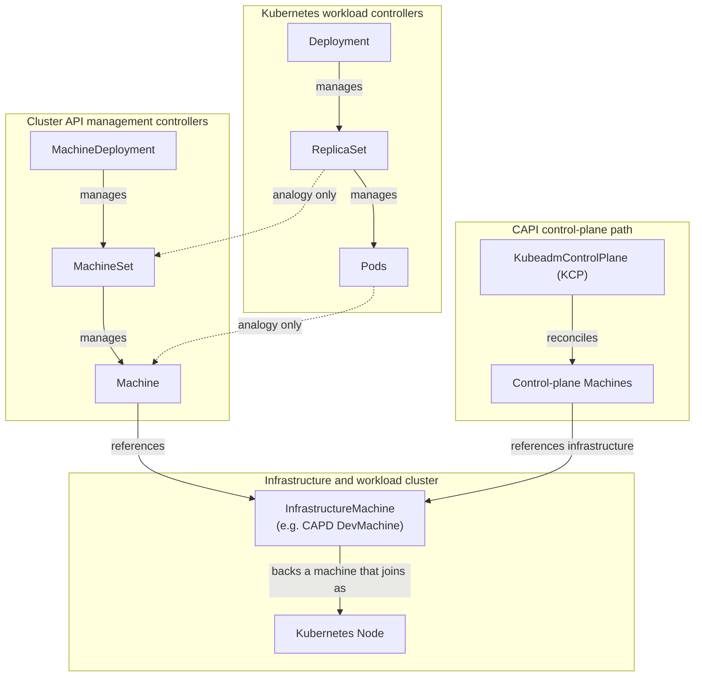

# Build a local OpenKubes BYOH development environment with CAPD

> **Publication draft — 20 November 2026**
>
> This tutorial documents the local CAPD developer environment being built in
> `openkubes/ok-baremetal-byoh`. The management-cluster bootstrap and its
> controller/Docker-socket smoke test have been executed successfully on
> macOS Apple Silicon with Colima. The CAPD workload manifest has also passed
> Kubernetes server-side dry-run validation. The first full workload-cluster
> creation and deletion must still be completed and recorded before this
> tutorial is considered fully end-to-end verified.

## What you will build

You will create an isolated local Cluster API (CAPI) management cluster using
Kind, then install the Cluster API Docker infrastructure provider (CAPD).
CAPD lets CAPI create disposable Kubernetes workload-cluster machines as
Docker containers.

The environment is intended for OpenKubes contributors developing and testing
the BYOH infrastructure provider. CAPD supplies repeatable, disposable
infrastructure; BYOH remains the provider under development.

The workflow is deliberately separate from the existing local BYOH management
workflow:

| Environment | Purpose | Kind cluster | Kubeconfig |
| --- | --- | --- | --- |
| Existing BYOH workflow (`make ok-up`) | BYOH management and host lifecycle | `ok-byoh-dev` | `~/.config/ok/byoh-dev/kubeconfig` |
| Local CAPD workflow (`make ok-capd`) | Disposable CAPI/CAPD development | `ok-capd-dev` | `~/.config/ok/capd/kubeconfig` |

They must not share a Kind cluster or kubeconfig. The CAPD workflow does not
use Scaleway inventories, SSH tunnels, OpenTofu state or BYOH host credentials.
It does not modify `ok-up`.

## 1. A short introduction to Cluster API

Kubernetes manages the workloads running inside a cluster. Cluster API manages
the lifecycle of Kubernetes clusters themselves.

CAPI runs in a **management cluster**. Its controllers reconcile declarative
CAPI objects and call infrastructure and bootstrap providers to create or
configure the machines that form a separate **workload cluster**.

A CAPI `Machine` is not the same object as a Kubernetes `Node`:

- A CAPI `Machine` is a management-plane API object representing a machine
  that should exist in a workload cluster. It records the desired Kubernetes
  version, bootstrap configuration and infrastructure reference.
- An infrastructure provider creates the underlying infrastructure object and
  machine. CAPD uses Docker containers; BYOH connects CAPI lifecycle to an
  existing host.
- Once the machine has bootstrapped and joined the workload cluster, the
  workload cluster's kubelet registers a Kubernetes `Node`.
- CAPI controllers use provider status and workload-cluster observations to
  reconcile the `Machine` lifecycle. A `Machine` and a `Node` are related,
  but they are different API objects with different responsibilities.

### The controller hierarchy and its Kubernetes analogy

The following analogy is useful when learning CAPI. It describes the
*relationship between controllers*, not identical APIs or identical runtime
semantics.



Read the worker side from top to bottom:

| Cluster API | Rough Kubernetes analogy | Responsibility |
| --- | --- | --- |
| `MachineDeployment` | `Deployment` | Declares the desired number and template of worker Machines; manages MachineSets |
| `MachineSet` | `ReplicaSet` | Keeps the desired number of Machines |
| `Machine` | No exact equivalent; a Pod is the closest *lifecycle-object* analogy | Represents one workload-cluster machine and connects bootstrap and infrastructure references |
| InfrastructureMachine | Underlying compute backing a Node | Provider-specific machine resource; for CAPD this is a Docker-backed machine |
| Kubernetes `Node` | Kubernetes `Node` | The actual node registered by kubelet in the workload cluster |

A worker `MachineDeployment` therefore manages `MachineSet` objects, and a
`MachineSet` manages `Machine` objects. This resembles a Kubernetes
`Deployment` managing `ReplicaSets`, which manage `Pods`. It is a useful
mental model, but a CAPI Machine is not a Pod and a Kubernetes Node is not a
MachineSet.

The control plane normally follows a different path. The
`KubeadmControlPlane` (KCP) controller manages control-plane Machines and
their kubeadm configuration. It is responsible for control-plane rollout and
health behavior; it does **not** create a MachineDeployment/MachineSet chain.
KCP has a high-level desired-state role, but it is not a one-to-one equivalent
of a Kubernetes Deployment or StatefulSet.

The CAPI `Cluster` object ties the workload cluster together. It references
an infrastructure-cluster object (for CAPD, a `DevCluster`) and a control
plane object (for this tutorial, a `KubeadmControlPlane`).

### What CAPD and BYOH contribute

CAPI core defines the common cluster and machine lifecycle APIs. Providers
implement the infrastructure- and bootstrap-specific parts:

- **CAPD** (Cluster API Provider Docker) provisions disposable Docker-backed
  infrastructure. It is ideal for repeatable local tests and CI.
- **BYOH** (Bring Your Own Host) manages existing Linux hosts through the
  OpenKubes BYOH infrastructure provider and its host agent. It is the provider
  being developed here.

Using CAPD for the test substrate does not mean BYOH is replaced by CAPD.
The same CAPI concepts can be exercised against different infrastructure
providers, while each provider retains its own infrastructure resources and
operational boundaries.

## 2. Architecture and pinned versions

The initial local management cluster contains:

- Kind / Kubernetes node image: `kindest/node:v1.36.4`
- CAPI core: `v1.14.4`
- Kubeadm Bootstrap provider: `v1.14.4`
- Kubeadm Control Plane provider: `v1.14.4`
- CAPD: `v1.14.4`
- cert-manager: `v1.21.3`

The version contract is kept in
[`dev/ok-capd/versions.env`](../../dev/ok-capd/versions.env). Keep the CAPI
providers on the same release line. Do not infer the local cluster version
from the provider repository's Go module: the repository's current Go
dependencies and the local CAPI management-cluster version are separate
versioning concerns.

The Kind node mounts `/var/run/docker.sock`. CAPD's controller also mounts
that socket so it can create and manage Docker containers. Access to this
socket is effectively Docker-daemon-level authority. Use only a dedicated
local development Docker daemon, never a shared or production daemon.

## 3. Prerequisites

Install and make the following tools available on `PATH`:

- Docker CLI and a running Docker daemon that runs Linux containers
- kind
- kubectl
- clusterctl `v1.14.4`
- jq
- Python 3 (used by the pinned template renderer)

On macOS, Docker Desktop or Colima can provide the Linux Docker daemon. On
Linux, use a local Docker Engine. Confirm that the active Docker context is
the intended disposable development daemon:

```bash
docker context show
docker info
kind version
kubectl version --client
clusterctl version
jq --version
python3 --version
```

The tested macOS/Apple Silicon setup used a Colima profile with 6 CPUs and
16 GiB RAM. Those resources were sufficient for the management cluster and
the first small workload-cluster test. Workload-cluster creation will need
additional memory and CPU beyond the management cluster itself.

### macOS / Colima limits

The first Kind node start on the tested Colima profile failed before reaching
systemd's multi-user target. The local shell had an open-file soft limit of
256 and the Colima VM had `fs.inotify.max_user_instances=128`. The test was
rerun successfully after raising the shell limit and the VM's inotify
instances. This sequence is recorded as an observed troubleshooting measure;
it does not prove either limit was the sole root cause.

For the tested shell session:

```bash
ulimit -n 65536
```

For the Colima profile used by the Docker context (example profile name
`ok-cli-kvm`):

```bash
colima ssh --profile ok-cli-kvm -- sudo sysctl -w \
  fs.inotify.max_user_instances=512

colima ssh --profile ok-cli-kvm -- \
  sysctl fs.inotify.max_user_instances fs.inotify.max_user_watches
```

These are runtime settings; they may need to be reapplied after a VM restart.
Do not change unrelated Colima profiles. Confirm the Docker context endpoint
and profile before making changes.

## 4. Create the CAPD management cluster

Clone the repository and enter its root directory. During development, use
the `feat/ok-capd-local-dev-environment` branch; after this work is merged,
the tutorial commands will be available from the default branch.

```bash
git clone https://github.com/openkubes/ok-baremetal-byoh.git
cd ok-baremetal-byoh
git checkout feat/ok-capd-local-dev-environment
```

Run the bootstrap:

```bash
make ok-capd
```

On first run this command:

1. Runs a read-only prerequisite check.
2. Creates the dedicated Kind cluster `ok-capd-dev` if it does not exist.
3. Writes its private kubeconfig to
   `~/.config/ok/capd/kubeconfig` (directory mode `0700`, file mode
   `0600`).
4. Runs `clusterctl init` for CAPI core, Kubeadm Bootstrap, Kubeadm Control
   Plane and CAPD, all pinned to `v1.14.4`.
5. Installs cert-manager `v1.21.3` through the pinned clusterctl
   configuration.
6. Verifies the provider inventory and reports management-cluster status.

A repeated `make ok-capd` preserves an existing verified cluster. It does not
blindly re-run provider initialization. Unexpected or partial states fail
closed for manual inspection.

The workflow always passes its dedicated kubeconfig to Kubernetes operations.
It does not rely on the current kubectl context or the ambient
`KUBECONFIG` variable.

## 5. Verify the management cluster

Run:

```bash
make ok-capd-status
make ok-capd-test
```

The status command reports the Kind node, provider inventory, controller
deployments and any CAPI workload Clusters.

The smoke test verifies:

- the four expected CAPI providers are registered at `v1.14.4`;
- CAPI core, both Kubeadm providers, CAPD and all three cert-manager
  deployments roll out successfully;
- the Docker socket is present in the Kind node and mounted by the CAPD
  controller.

On the tested macOS/Apple Silicon setup, all seven provider/cert-manager
controller deployments reached `1/1` and the smoke test passed.

At this point the management cluster is ready, but no CAPD workload cluster
has been created yet.

## 6. Render and validate the first CAPD workload manifest

The CAPD provider's component installation and its workload-cluster template
are separate artifacts. In CAPI `v1.14.4`, the Docker provider is installed
from `infrastructure-components-development.yaml`; the default
`clusterctl generate cluster` lookup for a release asset named
`cluster-template.yaml` does not succeed for this provider/version.

For this local workflow, the repository therefore pins the relevant upstream
CAPI `v1.14.4` E2E template sources under
[`dev/ok-capd/templates/upstream-v1.14.4/`](../../dev/ok-capd/templates/upstream-v1.14.4/).
The renderer combines the upstream cluster, worker and ClusterResourceSet
resources, substitutes the local values and embeds the pinned kindnet CNI
manifest.

Render without changing the management cluster:

```bash
make ok-capd-workload-render
```

The rendered file is written to:

```text
/tmp/ok-capd-smoke.yaml
```

Inspect the objects:

```bash
grep -E '^kind:|^  name:|^  replicas:' /tmp/ok-capd-smoke.yaml
wc -l /tmp/ok-capd-smoke.yaml
```

Validate against the management cluster API without persisting resources:

```bash
kubectl --kubeconfig "$HOME/.config/ok/capd/kubeconfig" \
  apply --dry-run=server -f /tmp/ok-capd-smoke.yaml
```

The initial template contains a `DevCluster`, CAPI `Cluster`,
control-plane and worker `DevMachineTemplate` objects, a
`KubeadmControlPlane`, a `KubeadmConfigTemplate`, a `MachineDeployment`,
a CNI ConfigMap and a `ClusterResourceSet`.

A successful server-side dry run means the API server accepts the objects and
their schemas. It does **not** prove that CAPD can create machines or that the
workload cluster will become Ready.

## 7. Create and inspect the CAPD workload cluster

After reviewing the rendered manifest and successful server-side dry run, the
workload lifecycle targets are:

```bash
make ok-capd-workload-up
make ok-capd-workload-status
```

The intended smoke cluster is named `ok-capd-smoke`, with one control-plane
machine and one worker, both running Kubernetes `v1.36.4`.

The workload-up workflow re-renders the pinned template, performs a
server-side dry run, applies the CAPI objects, waits for the CAPI Cluster,
KubeadmControlPlane and MachineDeployment to become Ready, extracts the
workload kubeconfig from the CAPI-generated Secret and waits for workload
Kubernetes Nodes to become Ready.

The workload kubeconfig is kept separately at:

```text
~/.config/ok/capd/workloads/ok-capd-smoke.kubeconfig
```

The management kubeconfig remains
`~/.config/ok/capd/kubeconfig`. Never commit either kubeconfig.

> **Verification status:** The manifest rendering and server-side dry run
> passed on 20 November 2026. The first live execution of
> `make ok-capd-workload-up` and the resulting Machine/Node readiness must be
> recorded here after it has been run successfully.

## 8. Delete only the CAPD workload cluster

When the workload lifecycle has been verified, delete the disposable workload
through CAPI:

```bash
OK_CAPD_CONFIRM_WORKLOAD_DELETE=ok-capd-smoke \
  make ok-capd-workload-down
```

The command requires explicit confirmation, deletes only the CAPI Cluster
named `ok-capd-smoke`, waits for the Cluster and its Machines to disappear,
and checks that CAPD-labelled Docker containers have been removed. It then
removes only the workload kubeconfig.

The Kind management cluster `ok-capd-dev` is preserved.

Do not manually remove CAPD containers while their CAPI resources still
exist. CAPI must drive infrastructure deletion so that Kubernetes objects and
Docker infrastructure remain consistent.

## 9. CAPD and BYOH: two providers, one CAPI lifecycle model

CAPD is useful for local development because it creates disposable Docker
machines quickly and consistently. It is not a substitute for testing the
behavior of BYOH on real Linux hosts.

The development strategy is:

1. Use CAPD for fast, isolated CAPI and controller experiments.
2. Install the OpenKubes BYOH provider into a separate test stage of the
   management environment when its integration plan is ready.
3. Exercise BYOH-specific host registration, infrastructure lifecycle and
   host-agent behavior against dedicated test hosts.
4. Reuse the CAPI-level test concepts where appropriate, while keeping
   provider-specific resources and evidence separate.

The initial CAPD bootstrap does not install the BYOH provider, RuntimeSDK
extensions or the No-Replacement Guard.

## 10. RuntimeSDK and No-Replacement test stages

The next development stages will integrate the existing OpenKubes test
harnesses rather than recreate them:

- RuntimeSDK accept, decline, update failure and controller restart cases;
- in-place upgrade evidence and identity-preservation checks;
- No-Replacement Guard admission tests, including denied replacement and
  deletion operations;
- test evidence and failure classification.

The Make targets for these stages must not be treated as passing tests until
the corresponding existing spike assets have been inventoried, integrated and
executed in this isolated environment.

## 11. Troubleshooting and lessons from the first run

### Kind cannot find the systemd multi-user boot log

Observed error:

```text
could not find a log line that matches
"Reached target .*Multi-User System.*|detected cgroup v1"
```

The first attempt failed while preparing the Kind node. After checking the
Colima profile, raising the shell file-descriptor limit and increasing the
Colima VM's inotify instances, the next attempt created the Kind node
successfully. Check the Docker context, the correct Colima profile, available
resources and VM limits before changing Kubernetes or Kind versions.

### Provider verification reports the wrong version

CAPI `Provider` inventory objects expose `version` at the resource root,
not under `.spec.version`. Inspect with:

```bash
kubectl --kubeconfig "$HOME/.config/ok/capd/kubeconfig" \
  get providers.clusterctl.cluster.x-k8s.io -A -o wide
```

### clusterctl connects to the wrong Kubernetes API endpoint

Always pass the CAPD kubeconfig explicitly to commands that support it:

```bash
clusterctl generate cluster ... --kubeconfig "$HOME/.config/ok/capd/kubeconfig"
```

The CAPD workflow must not depend on the ambient kubeconfig or current
kubectl context.

### clusterctl cannot find the CAPD cluster template

The CAPI v1.14.4 Docker provider component artifact does not provide the
expected release `cluster-template.yaml`. Use the repository's pinned
upstream E2E template renderer instead of assuming that
`clusterctl generate cluster` can fetch a default CAPD template.

### A helper script returns Permission denied

The Make targets invoke helper scripts with `bash` explicitly. Keep that
pattern when adding new scripts unless executable file modes are deliberately
set and verified in Git.

## 12. Cleanup the entire local CAPD management environment

Normally, keep the management cluster running between development sessions.
The workload can be created and deleted independently.

If the entire disposable CAPD environment must be removed, first ensure all
CAPI workload Clusters and Machines have been deleted. Then run:

```bash
make ok-capd-down
OK_CAPD_CONFIRM_DELETE=ok-capd-dev make ok-capd-clean
```

The cleanup target is restricted to the dedicated `ok-capd-dev` Kind cluster,
requires explicit confirmation and refuses to proceed while CAPI workload
Clusters, Machines or CAPD-labelled Docker containers remain.

Never use `kind delete clusters --all`. Never delete the existing BYOH
management clusters as part of CAPD cleanup.

## Evidence and reproducibility checklist

When following this tutorial, record the following in the test log or CI
artifact:

- repository commit SHA and branch;
- Docker context and Colima profile (if applicable);
- versions of Docker, kind, kubectl, clusterctl and Python;
- CAPI/CAPD provider inventory and cert-manager version;
- `make ok-capd-status` and `make ok-capd-test` output;
- rendered template SHA256 and server-side dry-run output;
- CAPI Cluster, KubeadmControlPlane, MachineDeployment and Machine status;
- workload-cluster Node readiness;
- workload deletion result and remaining CAPD Docker containers.

Keep raw kubeconfigs, certificates, tokens and private host information out of
Git and public issue attachments.
